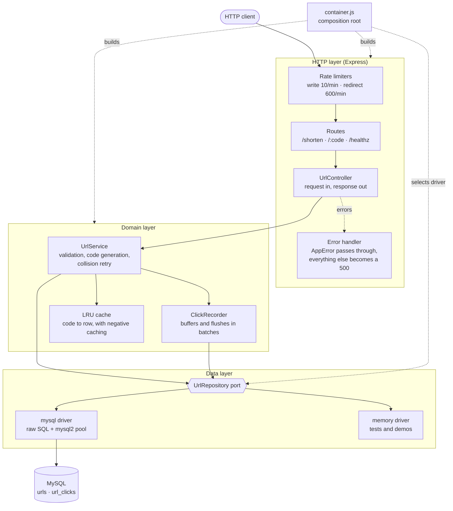
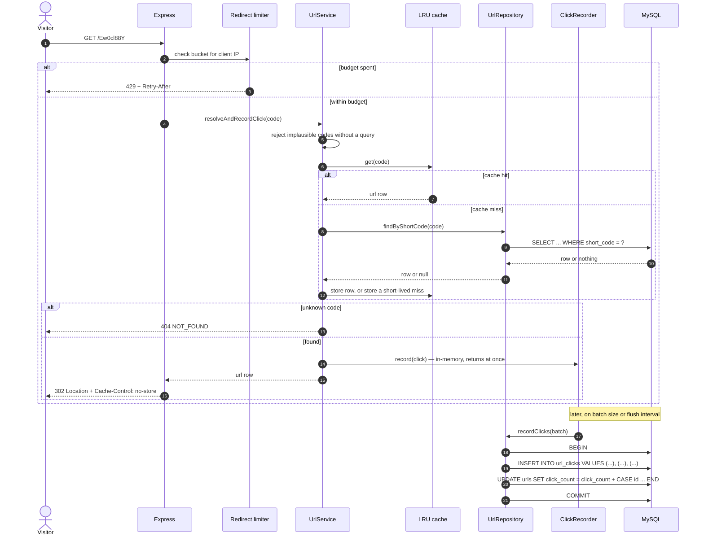

# URL Shortener Service

A Bit.ly-style URL shortener built as a backend take-home: `POST /shorten`
stores a long URL under a generated code, `GET /:code` sends a visitor to it
and records the click. Node.js, Express 5 and MySQL, with raw SQL only — no ORM
and no query builder, which was the point of the exercise.

The interesting part is not the two endpoints; it is what sits behind them: a
repository port with a swappable driver, a read-through cache on the redirect
path, and click analytics written in batches off the hot path.

## Captured output

There is no UI. The evidence is real terminal output from a real run against a
real MySQL server, captured in full under [`docs/`](docs/):

- **[`docs/api-walkthrough.md`](docs/api-walkthrough.md)** — every endpoint and
  every error shape, plus the rows they produced in MySQL.
- **[`docs/performance.md`](docs/performance.md)** — the measured effect of the
  cache and the batching writer, with the measurement caveats stated.

```console
$ curl -s -i -X POST http://localhost:8520/shorten \
    -H 'Content-Type: application/json' \
    -d '{"url": "https://developer.mozilla.org/en-US/docs/Web/HTTP/Status/302"}'
HTTP/1.1 201 Created
RateLimit-Limit: 10
RateLimit-Remaining: 9
RateLimit-Reset: 1790261458
Content-Type: application/json; charset=utf-8

{"shortUrl":"http://localhost:8520/tiOUXxgG","code":"tiOUXxgG","originalUrl":"https://developer.mozilla.org/en-US/docs/Web/HTTP/Status/302"}

$ curl -s -o /dev/null -D - http://localhost:8520/Ew0cl88Y
HTTP/1.1 302 Found
RateLimit-Limit: 600
RateLimit-Remaining: 599
Cache-Control: private, no-store
Location: https://www.postgresql.org/docs/current/indexes-types.html
```

And what that second request left behind:

```console
$ mysql -u root url_shortener -e 'SELECT url_id, clicked_at, ip_address, user_agent FROM url_clicks ORDER BY id;'
url_id	clicked_at	ip_address	user_agent
2	2026-09-24 19:49:57	::1	curl/8.7.1
2	2026-09-24 19:49:57	::1	curl/8.7.1
2	2026-09-24 19:49:57	::1	curl/8.7.1
```

## Architecture



Dependencies point inward. The controller knows the service; the service knows
the repository _port_; only the MySQL driver knows `mysql2`. Nothing below the
HTTP layer has ever seen a `req` or a `res`.

## Redirect flow

The path a visitor actually takes, including what happens after the response
is already on its way back:



## Quickstart

Requires Node.js 22+ and, for the default driver, a MySQL server.

```bash
npm install
cp .env.example .env     # then set your MySQL credentials
npm run db:init          # creates the database and both tables
npm run dev              # http://localhost:3000
```

No MySQL to hand? The in-memory driver runs the whole service without one:

```bash
STORAGE_DRIVER=memory npm start
```

Then:

```bash
curl -X POST http://localhost:3000/shorten \
  -H 'Content-Type: application/json' \
  -d '{"url":"https://example.com/a/very/long/path"}'
# {"shortUrl":"http://localhost:3000/Ab12xyZ9","code":"Ab12xyZ9","originalUrl":"..."}

curl -i http://localhost:3000/Ab12xyZ9
# HTTP/1.1 302 Found  ·  Location: https://example.com/a/very/long/path
```

### With Docker

```bash
docker compose up --build         # app on :3000, MySQL on :3306
```

Compose brings up MySQL, runs the schema as a one-shot `migrate` service, then
starts the app. **Not yet verified:** the image has been authored but never
built or booted — see [Limitations](#limitations).

## API

| Method | Path       | Success            | Notes                            |
| ------ | ---------- | ------------------ | -------------------------------- |
| `POST` | `/shorten` | `201` + JSON       | Body `{"url": "https://..."}`    |
| `GET`  | `/:code`   | `302` + `Location` | Records one click                |
| `GET`  | `/healthz` | `200` liveness     | Process is up; no database check |
| `GET`  | `/readyz`  | `200` / `503`      | Pings storage                    |

Errors share one envelope, and the `code` is the stable part:

```json
{
  "error": {
    "code": "RATE_LIMIT_EXCEEDED",
    "message": "Rate limit exceeded.",
    "details": { "retryAfterSeconds": 58, "limit": 10, "windowMs": 60000 }
  }
}
```

`VALIDATION_ERROR` (400), `BAD_REQUEST` (400), `PAYLOAD_TOO_LARGE` (413),
`NOT_FOUND` (404), `RATE_LIMIT_EXCEEDED` (429), `CODE_GENERATION_FAILED` (503),
`INTERNAL_ERROR` (500). A 500 carries an `incidentId` and nothing else; the
detail stays in the logs.

## Configuration

Every variable the application reads. All are optional — the defaults run.

| Variable                           | Required | Default                 | Purpose                                                         |
| ---------------------------------- | -------- | ----------------------- | --------------------------------------------------------------- |
| `NODE_ENV`                         | no       | `development`           | Reported in the startup log.                                    |
| `PORT`                             | no       | `3000`                  | Listen port. `0` binds an ephemeral port.                       |
| `BASE_URL`                         | no       | `http://localhost:3000` | Prefix for the `shortUrl` in responses; trailing `/` trimmed.   |
| `LOG_LEVEL`                        | no       | `info`                  | `debug`, `info`, `warn`, `error`, `silent`.                     |
| `TRUST_PROXY`                      | no       | `false`                 | Trust `X-Forwarded-For` for `req.ip`. See Design notes.         |
| `SHUTDOWN_TIMEOUT_MS`              | no       | `10000`                 | Force-exit backstop for a hung graceful shutdown.               |
| `STORAGE_DRIVER`                   | no       | `mysql`                 | `mysql` or `memory`.                                            |
| `DB_HOST`                          | no       | `127.0.0.1`             | MySQL host.                                                     |
| `DB_PORT`                          | no       | `3306`                  | MySQL port.                                                     |
| `DB_USER`                          | no       | `root`                  | MySQL user.                                                     |
| `DB_PASSWORD`                      | no       | _(empty)_               | MySQL password.                                                 |
| `DB_NAME`                          | no       | `url_shortener`         | Database name; also what `db:init` creates.                     |
| `DB_POOL_SIZE`                     | no       | `10`                    | Pool connection limit.                                          |
| `SHORT_CODE_LENGTH`                | no       | `8`                     | Base62 characters per code.                                     |
| `SHORT_CODE_MAX_ATTEMPTS`          | no       | `5`                     | Retries before giving up on a unique code.                      |
| `CACHE_MAX_ENTRIES`                | no       | `10000`                 | LRU capacity for code → row.                                    |
| `CACHE_TTL_MS`                     | no       | `300000`                | TTL for a cached row.                                           |
| `CACHE_MISS_TTL_MS`                | no       | `5000`                  | TTL for a cached _miss_ (blunts code scanning).                 |
| `CLICK_IP_MODE`                    | no       | `full`                  | `full`, `anonymized` (drop last octet / keep IPv6 /48), `none`. |
| `CLICK_BATCH_SIZE`                 | no       | `50`                    | Clicks buffered before an early flush.                          |
| `CLICK_FLUSH_MS`                   | no       | `1000`                  | Flush interval. Sets the click-count staleness window.          |
| `CLICK_QUEUE_MAX`                  | no       | `10000`                 | Buffer cap; beyond it analytics are dropped, not queued.        |
| `RATE_LIMIT_MAX_REQUESTS`          | no       | `10`                    | `POST /shorten` budget per client per window.                   |
| `RATE_LIMIT_WINDOW_MS`             | no       | `60000`                 | Write window length.                                            |
| `REDIRECT_RATE_LIMIT_MAX_REQUESTS` | no       | `600`                   | `GET /:code` budget per client per window.                      |
| `REDIRECT_RATE_LIMIT_WINDOW_MS`    | no       | `60000`                 | Redirect window length.                                         |
| `RATE_LIMIT_CLEANUP_MS`            | no       | `60000`                 | Sweep interval for expired buckets.                             |
| `RATE_LIMIT_MAX_CLIENTS`           | no       | `100000`                | Hard cap on tracked clients.                                    |

`TEST_MYSQL=1` additionally opts the MySQL integration tests in, and
`BENCH_URL` / `BENCH_REQUESTS` / `BENCH_CONCURRENCY` / `BENCH_LABEL` drive
`scripts/bench-redirect.js`. Neither is read by the application.

## Development

```bash
npm run dev             # nodemon
npm test                # node:test — 104 tests, no database required
npm run test:coverage   # with V8 coverage
npm run lint            # eslint (flat config)
npm run format          # prettier
```

The default suite uses the in-memory driver, so it needs nothing installed and
finishes in well under a second. `npm run test:coverage` reports **91.93% line
and 95.30% branch coverage** across `src/` and `scripts/`. The raw SQL is covered separately, against a
real server:

```bash
TEST_MYSQL=1 DB_NAME=url_shortener_test npm run test:mysql
```

That suite skips itself when `TEST_MYSQL` is unset. It is what proves the
hand-written SQL — the multi-row insert, the `CASE`-based grouped update, the
unique-index collision path — actually does what the unit tests assume.

## Project structure

```
src/
  server.js                  Process: listen, signals, graceful shutdown
  container.js               Composition root — the only place things are wired
  app.js                     Express assembly; takes collaborators, reads no env
  routes/                    Route tables (url, health)
  controllers/               Request in, response out. Nothing else.
  services/
    url.service.js           Business logic: validation, codes, collisions
    clickRecorder.js         Buffers clicks, flushes them in batches
  repositories/
    index.js                 Driver registry — the extension seam
    mysql.repository.js      Raw SQL; the only module that imports mysql2
    memory.repository.js     Same port, in process
  constants/queries.js       Every SQL statement, plus the two batch builders
  middleware/                Rate limiter, error handler, request logger
  lib/                       LRU cache, structured logger
  config/                    loadConfig(env), MySQL pool factory
  utils/                     Errors, URL validation, IP handling, code generation
sql/schema.sql               Table DDL
scripts/
  init-db.js                 Creates the database, applies the schema
  bench-redirect.js          Load probe behind docs/performance.md
  lib/splitSqlStatements.js  SQL splitter, extracted so it can be tested
tests/
  unit/                      Pure logic, no I/O
  integration/api.test.js    Real HTTP against the real stack, memory driver
  integration/mysql.*.test.js Raw SQL against a real MySQL server (opt-in)
docs/                        Captured output and measurements
```

## Design notes

**Layering, and why the seams are where they are.** The original put SQL in
model modules that imported a shared pool singleton, and built the Express app
at import time. That is untestable without a database: importing anything
opened a connection. Now `createApp` takes its collaborators, `container.js`
does all the wiring, and `loadConfig(env)` takes the environment as an
argument. The whole suite runs the real middleware stack in-process with no
MySQL anywhere.

**The repository port is the one extension seam.** Adding Postgres means one
module and one line in `src/repositories/index.js`. Nothing above the data
layer changes, because the service never sees a driver error: the MySQL driver
translates `ER_DUP_ENTRY` into a `DuplicateShortCodeError`, and the collision
retry loop in the service is written against that domain error. `memory` is
not a mock for tests — it is a second real implementation of the port, which
is what makes it worth having.

**The bottleneck was the redirect.** Writes are rare; reads are the product.
The original did `SELECT` → `BEGIN` → `UPDATE` → `INSERT` → `COMMIT`
_synchronously_, per redirect, before the visitor got a `302`. Two changes:

1. _A read-through cache._ Rows are immutable once written — there is no update
   or delete endpoint — so a cached destination can never go stale. Misses are
   cached briefly too, so scanning random codes does not become one query per
   guess. Measured: 500 sequential redirects of one code cost **2 `SELECT`s
   instead of 199**.
2. _Batched click writes._ A click is buffered in memory and the response goes
   out immediately; a flush drains the buffer in one transaction — one
   multi-row `INSERT` plus one `UPDATE ... CASE id`. Measured: 3000 redirects
   cost **62 `INSERT`s, 62 `UPDATE`s and 62 transactions** rather than 3000 of
   each. That grouped `UPDATE` also matters for lock contention: incrementing a
   popular link once per redirect serialises every concurrent visitor behind
   the same InnoDB row lock.

   Full figures, caveats and how to reproduce: [`docs/performance.md`](docs/performance.md).

**Collision handling is a write, not a read.** Generating a code and checking
whether it exists before inserting is a race between the check and the insert.
The unique index on `short_code` is the authority; the service inserts, catches
the violation, and tries again. At 62⁸ ≈ 2.2 × 10¹⁴ codes the retry branch is
effectively dead weight — which is why it is worth testing rather than trusting.

**Short codes come from `crypto.randomInt`, not `Math.random`.** A short code
is the only thing standing between a link and anyone who wants to enumerate
links. `Math.random` is a seeded PRNG whose future output is derivable from
past samples — fine for jitter, not for something that acts as a capability.

**`trust proxy` is off by default.** The original set it to `true`
unconditionally, which means `req.ip` comes from a client-supplied
`X-Forwarded-For` header — and the rate limiter keyed on `req.ip` can then be
bypassed with one header, or used to inflate the bucket map without limit.
It is now opt-in via `TRUST_PROXY`, for deployments where a proxy you control
is guaranteed to rewrite that header. Both behaviours are covered by tests.

**Two rate-limit budgets.** The brief asked for per-IP rate limiting, and the
write budget keeps its original `10 / 60s`. But applying that same budget to
redirects would 429 the eleventh visitor per minute from any office or mobile
carrier behind one NAT address — so the redirect path gets its own, larger
bucket. Both are fixed-window and in-process, which is honest about its limit:
fine for one instance, wrong across several. See Limitations.

**Errors never leak internals.** Only an `AppError` — something the application
authored deliberately — has its message returned. Anything else becomes
`INTERNAL_ERROR` with a UUID that appears in the logs. Previously a driver
failure returned the database host, user and SQL text straight to the caller.

**Logs carry no personal data.** Click analytics store an IP and a user-agent
because the brief asked for them, and `CLICK_IP_MODE=anonymized` coarsens the
IP for deployments that would rather not. Application logs carry neither —
method, route, status and duration only.

## Limitations

- **The Docker image is authored but unverified.** It has never been built or
  booted; the Docker daemon was unavailable in the environment this was
  finished in. `docker compose config` parses cleanly, which is all that has
  been checked.
- **Rate limiting is per process.** Buckets live in one Node heap. Two replicas
  behind a load balancer give each client two budgets. A shared store (Redis
  `INCR` with an expiry) is the fix; it is not here because it would be the
  only piece of infrastructure the exercise does not otherwise need.
- **The cache is per process too**, so cache hit rate falls as instances are
  added, and there is no invalidation path — correct only because rows are
  immutable. The moment an edit-URL or delete-URL endpoint exists, this needs
  invalidation.
- **Click counts are eventually consistent** within `CLICK_FLUSH_MS` (default
  1 s), and `SIGKILL` can lose up to one buffer of clicks. `SIGTERM` flushes
  first. If clicks were billing events rather than analytics this trade would
  be wrong.
- **A failed click batch is logged and dropped**, not retried. Analytics must
  not take the redirect path down with them.
- **No authentication, ownership or custom aliases.** Anyone can shorten
  anything and every code is public. There is no per-user quota beyond the IP
  rate limit.
- **No analytics read API.** Clicks are recorded and counted; nothing reads
  them back out over HTTP. The brief specified two endpoints and this stays at
  two.
- **The shortener will happily redirect to anything `http(s)`**, including a
  host that turns malicious later. A production deployment would want a
  reputation check at creation time and a revocation path.
- **`GET /:code` is a catch-all single path segment.** Anything that must not
  be mistaken for a short code has to be registered before it — as `/healthz`
  and `/readyz` are.
